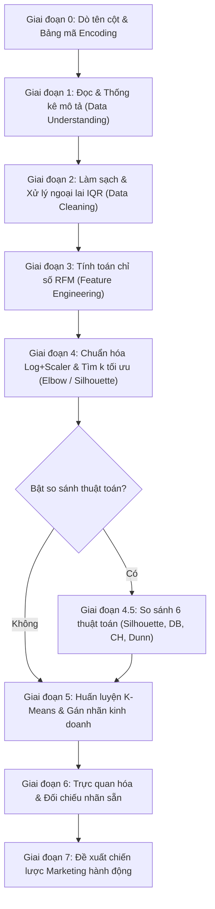

# TÀI LIỆU HƯỚNG DẪN SỬ DỤNG VÀ CHÚ THÍCH HỆ THỐNG PHÂN CỤM KHÁCH HÀNG RFM + K-MEANS

> **Dự án:** RFM Customer Segmentation & Machine Learning Clustering Pipeline  
> **Phiên bản:** Generic Pipeline 2.0  
> **Ngôn ngữ:** Python 3.8+  
> **Thư mục dự án:** `rfm-analyst`  

---

## 1. TỔNG QUAN HỆ THỐNG

### 1.1. Mục đích
Hệ thống được thiết kế để phân tích hành vi và phân khúc khách hàng tự động dựa trên mô hình **RFM (Recency - Frequency - Monetary)** kết hợp thuật toán phân cụm học máy **K-Means**, đồng thời hỗ trợ đối sánh định lượng với **5 thuật toán phân cụm phổ biến khác** (Gaussian Mixture Model, Fuzzy C-Means, DBSCAN, Mean Shift, Spectral Clustering) theo tiêu chuẩn các bài báo nghiên cứu chuyên ngành (như JABES 2025).

### 1.2. Tính "Generic" (Tổng quát hóa)
Pipeline được xây dựng theo kiến trúc linh hoạt:
- **Tự động nhận diện cấu trúc file:** Hỗ trợ đa dạng bộ dữ liệu bán lẻ (Online Retail, Supermarket, E-commerce, B2B, Siêu thị...) mà không cần viết lại mã nguồn.
- **Tự động dò tìm bảng mã (Encoding Detection):** Tự phát hiện file dạng `utf-8`, `utf-8-sig`, `cp1252`, `latin-1` giúp tránh lỗi đọc ký tự tiếng Việt hoặc ký tự đặc biệt.
- **Tự động khớp tên cột (Dynamic Column Mapping):** Quét tiêu đề cột bằng từ điển từ khóa thông minh (`CANDIDATES`). Người dùng chỉ cần can thiệp nếu tên cột quá dị biệt.

---

## 2. CẤU TRÚC THƯ MỤC VÀ TỆP TIN

```text
rfm-analyst/
│
├── rfm_kmeans_pipeline_generic.py    # Script Python thực thi toàn bộ pipeline (khuyên dùng chạy tự động)
├── rfm_kmeans_pipeline_generic.ipynb # Jupyter Notebook tương ứng (thích hợp trực quan hóa, phân tích từng bước)
├── HUONG_DAN_SU_DUNG.md             # Tài liệu hướng dẫn sử dụng và chú thích (file này)
├── Huong_dan_su_dung_va_Chu_thich.docx # Bản tài liệu Word phục vụ in ấn / báo cáo
│
└── outputs_rfm/                      # Thư mục chứa kết quả xuất ra sau khi chạy
    ├── rfm_table.csv                 # Dữ liệu RFM thô của từng khách hàng
    ├── rfm_with_clusters.csv         # Dữ liệu RFM kèm mã cụm (Cluster) và tên phân khúc (Cluster_Name)
    ├── cluster_summary.csv           # Bảng tổng hợp thống kê trung bình R-F-M và tỷ lệ từng cụm
    ├── algorithm_comparison.csv      # Bảng đối sánh chỉ số 6 thuật toán phân cụm
    ├── elbow_silhouette.png          # Đồ thị Elbow (WCSS) và Silhouette theo các giá trị k
    ├── algorithm_comparison_metrics.png # Đồ thị so sánh 4 chỉ số (Silhouette, DB, CH, Dunn)
    ├── algorithm_comparison_3d.png   # Không gian phân cụm 3D của các thuật toán
    ├── scatter_recency_monetary.png  # Biểu đồ phân tán Recency vs Monetary giữa các cụm
    └── bar_monetary_by_cluster.png   # Biểu đồ cột giá trị Monetary trung bình theo phân khúc
```

---

## 3. YÊU CẦU MÔI TRƯỜNG VÀ CÀI ĐẶT

### 3.1. Phiên bản Python
- Python phiên bản **3.8 trở lên** (Khuyên dùng Python 3.10 hoặc 3.11).

### 3.2. Cài đặt các thư viện cần thiết
Mở Terminal / Command Prompt / PowerShell và chạy câu lệnh:

```bash
pip install pandas numpy scikit-learn matplotlib seaborn python-docx
```

*Lưu ý trên môi trường Linux/Debian mới nếu gặp cảnh báo `externally-managed-environment`, thêm cờ `--break-system-packages`:*
```bash
pip install pandas numpy scikit-learn matplotlib seaborn python-docx --break-system-packages
```

---

## 4. HƯỚNG DẪN CẤU HÌNH (MỤC `CONFIG` TRONG CODE)

Khi áp dụng pipeline cho một bộ dữ liệu mới, bạn **CHỈ CẦN CHỈNH SỬA DUY NHẤT** phần `0. CONFIG` (từ dòng 68 đến dòng 92 trong file `rfm_kmeans_pipeline_generic.py`):

```python
# ====================================================================
# 0. CONFIG — PHẦN DUY NHẤT CẦN SỬA KHI ĐỔI BỘ DỮ LIỆU
# ====================================================================
DATA_PATH = r"D:\archive (6)\supermarket_large_dataset.csv"     # <-- Đường dẫn tới file CSV của bạn
OUTPUT_DIR = "outputs_rfm"                                       # <-- Thư mục lưu kết quả xuất ra
RANDOM_STATE = 42                                                # <-- Seed cố định để kết quả không bị đổi qua các lần chạy
FINAL_K = None                                                   # <-- Số cụm chốt: None (tự động chọn theo Silhouette) hoặc số nguyên (vd: 4)
RUN_ALGORITHM_COMPARISON = True                                  # <-- True: Chạy so sánh 6 thuật toán; False: Bỏ qua để chạy nhanh hơn
MAX_SAMPLE_FOR_HEAVY_ALGOS = 3000                               # <-- Giới hạn số mẫu cho thuật toán nặng (Spectral, Mean Shift, Dunn)

# Khai báo TÊN CỘT THẬT trong file của bạn. Để None để hệ thống tự động dò.
COLUMN_MAP = {
    "customer_id":    None,   # Mã khách hàng (bắt buộc)
    "transaction_id": None,   # Mã giao dịch/hóa đơn (bắt buộc)
    "date":           None,   # Ngày giao dịch (bắt buộc)
    "quantity":       None,   # Số lượng (cần nếu data chưa có sẵn cột amount)
    "unit_price":     None,   # Đơn giá (cần nếu data chưa có sẵn cột amount)
    "amount":         None,   # Thành tiền (ưu tiên dùng nếu data đã tính sẵn)
}

# Cột nhãn có sẵn để đối chiếu ở Giai đoạn 6 (vd: Churn, CLV, Loyalty Tier...)
EXTRA_LABEL_COLUMNS = None   # Để None để tự dò, hoặc truyền list tên cột: ["churn", "segment"]
```

### Chi tiết các tham số cấu hình:
1. **`DATA_PATH`**: Đường dẫn tuyệt đối hoặc tương đối trỏ tới file `.csv` cần phân tích.
2. **`FINAL_K`**:
   - Nếu đặt `None`: Script tự động lấy giá trị $k$ có điểm Silhouette trung bình cao nhất trong dải $k \in [2, 8]$.
   - Nếu đặt một số nguyên (ví dụ: `4`): Script sẽ ép buộc huấn luyện K-Means với đúng 4 cụm. *(Khuyên dùng `FINAL_K = 4` cho ứng dụng kinh doanh thực tế)*.
3. **`RUN_ALGORITHM_COMPARISON`**:
   - `True`: Chạy giai đoạn 4.5 so sánh K-Means với GMM, FCM, DBSCAN, Mean Shift, Spectral Clustering.
   - `False`: Bỏ qua bước so sánh thuật toán, chuyển thẳng từ xác định $k$ sang huấn luyện K-Means (tiết kiệm thời gian khi chạy file dữ liệu lớn).
4. **`MAX_SAMPLE_FOR_HEAVY_ALGOS`**:
   - Số lượng khách hàng tối đa dùng để chạy các thuật toán có độ phức tạp cao ($O(n^2)$ hoặc $O(n^3)$) như Spectral Clustering, Mean Shift và chỉ số Dunn Index. Mặc định là `3000` giúp tránh tràn bộ nhớ RAM.
5. **`COLUMN_MAP`**:
   - Nếu file dữ liệu dùng tên cột chuẩn tiếng Anh/tiếng Việt phổ biến (vd: `Customer_ID`, `InvoiceNo`, `Date`, `Total_Amount`), bạn cứ để tất cả là `None`.
   - Nếu cột có tên khác biệt (vd: `MaKH`, `SoChungTu`), hãy điền tên chính xác vào: `"customer_id": "MaKH"`.

---

## 5. QUY TRÌNH HOẠT ĐỘNG CHI TIẾT (8 GIAI ĐOẠN)

Hệ thống tuân thủ quy trình chuẩn Data Science / CRISP-DM:



### Chi tiết các giai đoạn:

* **Giai đoạn 0 - Dò cột tự động (Column Resolution):** Quét cấu trúc file, kiểm tra các cột bắt buộc (`customer_id`, `transaction_id`, `date`) và điều kiện tính tiền (`amount` HOẶC `quantity` + `unit_price`). Nếu thiếu, báo lỗi cụ thể hướng dẫn người dùng bổ sung.
* **Giai đoạn 1 - Khám phá dữ liệu (Data Understanding):** Đọc dữ liệu với encoding phù hợp, đổi tên về chuẩn nội bộ, chuyển đổi kiểu ngày tháng, thống kê số dòng, số khách hàng, số giao dịch và tỷ lệ giá trị thiếu (`missing values`).
* **Giai đoạn 2 - Làm sạch & Tiền xử lý (Data Cleaning):**
  - Loại bỏ các dòng thiếu thông tin định danh (`customer_id`, `transaction_id`, `date`).
  - Lọc bỏ số lượng âm hoặc đơn giá $\le 0$ (loại bỏ đơn hủy hoặc dữ liệu lỗi).
  - Loại bỏ các dòng trùng lặp (`drop_duplicates`).
  - Tính `LINE_TOTAL` (bằng `AMOUNT` hoặc `QUANTITY * UNIT_PRICE`).
  - **Xử lý ngoại lai (Outliers Capping):** Sử dụng phương pháp IQR (Interquartile Range), giới hạn trần chi tiêu ở ngưỡng $Q_3 + 1.5 \times IQR$ để tránh việc vài khách hàng mua số lượng quá đột biến làm bóp méo không gian phân cụm.
* **Giai đoạn 3 - Kỹ thuật đặc trưng RFM (Feature Engineering):**
  - Xác định ngày mốc tham chiếu (`snapshot_date = max(DATE) + 1 ngày`).
  - **Recency ($R$):** Số ngày từ lần mua cuối cùng của khách hàng tới ngày mốc tham chiếu (càng nhỏ nghĩa là khách mua càng gần đây).
  - **Frequency ($F$):** Số lượng giao dịch duy nhất (`nunique` của `TRANSACTION_ID`).
  - **Monetary ($M$):** Tổng số tiền khách hàng đã chi tiêu.
  - Xuất bảng kết quả ra file `outputs_rfm/rfm_table.csv`.
* **Giai đoạn 4 - Chuẩn hóa & Tìm số cụm tối ưu ($k$):**
  - Biến đổi `np.log1p(x)` để khử độ lệch phải (right-skewed) cực lớn của $F$ và $M$.
  - Chuẩn hóa phân phối chuẩn bằng `StandardScaler()` (đưa về trung bình 0, phương sai 1).
  - Chạy thử nghiệm $k \in [2, 8]$, vẽ đồ thị phương pháp khuỷu tay (Elbow/WCSS) và hệ số bóng đổ (Silhouette Score).
  - Xuất đồ thị `outputs_rfm/elbow_silhouette.png`.
* **Giai đoạn 4.5 - Đối sánh 6 thuật toán phân cụm:**
  - Chạy thực nghiệm 6 thuật toán: **K-Means**, **Spectral Clustering**, **Mean Shift**, **Gaussian Mixture Model (GMM)**, **DBSCAN**, **Fuzzy C-Means (FCM)**.
  - Tính toán 4 chỉ số đo lường độc lập:
    1. *Silhouette Score* (càng cao càng tốt)
    2. *Davies-Bouldin Index* (càng thấp càng tốt)
    3. *Calinski-Harabasz Index* (càng cao càng tốt)
    4. *Dunn Index* (càng cao càng tốt)
  - Tự động xếp hạng tổng hợp (Borda rank) để gợi ý thuật toán cân bằng nhất.
  - Xuất file `algorithm_comparison.csv`, đồ thị so sánh `algorithm_comparison_metrics.png` và không gian 3D `algorithm_comparison_3d.png`.
* **Giai đoạn 5 - Huấn luyện K-Means & Đặt tên cụm:**
  - Huấn luyện mô hình K-Means với số cụm đã chọn.
  - Phân tích chân dung từng cụm dựa trên bộ 3 giá trị trung bình ($R_{mean}, F_{mean}, M_{mean}$).
  - Tự động gán nhãn phân khúc kinh doanh logic (nếu $k=4$):
    1. **Best Customers (Khách hàng VIP/Tốt nhất):** Mua gần đây nhất, tần suất cao nhất, chi tiêu lớn nhất.
    2. **Loyal Customers (Khách hàng thân thiết):** Mua đều đặn, tần suất tốt, giá trị ổn định.
    3. **Potential Customers (Khách hàng tiềm năng):** Mới mua hoặc mua ít lần nhưng có tiềm năng phát triển.
    4. **Lost Customers (Khách hàng có nguy cơ rời bỏ):** Đã rất lâu không quay lại mua sắm, giá trị đóng góp thấp.
  - Xuất bảng chi tiết `rfm_with_clusters.csv` và bảng tóm tắt `cluster_summary.csv`.
* **Giai đoạn 6 - Trực quan hóa & Đối chiếu nhãn:**
  - Vẽ biểu đồ phân tán 2D `Recency vs Monetary`.
  - Vẽ biểu đồ cột so sánh mức chi tiêu trung bình giữa các phân khúc.
  - Bảng chéo (crosstab) kiểm định nếu dataset có sẵn nhãn churn/segment.
* **Giai đoạn 7 - Đề xuất chiến lược tiếp thị (Actionable Marketing Strategies):**
  - Đưa ra chiến lược cá nhân hóa theo từng phân khúc khách hàng nhằm tối ưu hóa ROI của các chiến dịch marketing.

---

## 6. CÁC ĐIỂM CẦN CHÚ Ý VÀ LƯU Ý KỸ THUẬT QUAN TRỌNG

### 6.1. Tại sao phải dùng Log Transform (`np.log1p`) trước khi chuẩn hóa?
> [!IMPORTANT]
> Trong dữ liệu bán lẻ thực tế, các biến **Frequency** và **Monetary** hầu như luôn tuân theo phân phối hàm mũ / lũy thừa (Power Law Distribution hoặc Right-Skewed): đa số khách hàng chỉ mua 1-2 lần với số tiền nhỏ, trong khi một số ít khách hàng chi tiêu số tiền khổng lồ.  
> Thuật toán K-Means sử dụng khoảng cách Euclidean (khoảng cách hình học phẳng) và giả định các cụm có dạng cầu đối xứng. Nếu không thực hiện biến đổi `log1p`:
> - Một vài khách hàng có Monetary cực lớn sẽ kéo tâm cụm về phía họ.
> - K-Means sẽ gom 95% khách hàng vào cùng 1 cụm khổng lồ và tạo ra các cụm chỉ có 1-2 khách ngoại lai.  
> Biến đổi `log1p(x) = ln(1 + x)` giúp nén dải giá trị, đưa phân phối về gần dạng phân phối chuẩn, giúp K-Means chia cụm đồng đều và chuẩn xác hơn rất nhiều.

### 6.2. Lưu ý về việc chọn số cụm $k$ (Toán học vs Thực tế Kinh doanh)
- Về mặt toán học: Đôi khi chỉ số Silhouette đạt giá trị cao nhất tại $k=2$ (vì chia đôi tập dữ liệu thành 2 nửa đối cực thường cho khoảng cách giữa 2 tâm lớn nhất).
- Về mặt nghiệp vụ: Phân khúc thành 2 cụm (khách mua nhiều vs khách mua ít) mang lại rất ít giá trị thực tiễn cho phòng Marketing vì không thể xây dựng kịch bản chăm sóc khách hàng đa tầng.
- **Khuyến nghị:** Thiết lập `FINAL_K = 4` để có đủ 4 nhóm kinh điển theo ma trận RFM. Trường hợp công ty có nhiều nguồn lực chăm sóc khách hàng, có thể cân nhắc $k=5$ hoặc $k=6$.

### 6.3. Kiểm soát hiệu năng với tập dữ liệu lớn
> [!WARNING]
> - Các thuật toán **Spectral Clustering**, **Mean Shift** và hàm tính **Dunn Index** có độ phức tạp tính toán rất lớn ($O(n^2)$ tới $O(n^3)$).
> - Nếu dữ liệu khách hàng vượt quá vài chục nghìn, việc chạy toàn bộ dữ liệu trên các thuật toán này sẽ gây **treo máy hoặc tràn RAM**.
> - Vì vậy, tham số `MAX_SAMPLE_FOR_HEAVY_ALGOS = 3000` đóng vai trò chốt chặn an toàn: thuật toán vẫn cho kết quả so sánh đại diện đáng tin cậy mà không làm sập tiến trình.
> - Nếu tập dữ liệu giao dịch của bạn có hàng triệu dòng và chỉ muốn phân cụm K-Means nhanh chóng, hãy đặt `RUN_ALGORITHM_COMPARISON = False`.

### 6.4. Xử lý giao dịch trả hàng / hoàn tiền (Returns & Refunds)
- Trong các bộ dữ liệu bán lẻ (ví dụ Online Retail UCI), các dòng hoàn trả thường có `Quantity < 0` hoặc mã hóa đơn bắt đầu bằng ký tự `'C'` (Cancelled).
- Pipeline hiện tại áp dụng chính sách: **Loại bỏ các giao dịch có số lượng âm hoặc thành tiền $\le 0$** ở Giai đoạn 2 nhằm tập trung phân tích hành vi mua hàng thực tế.
- Nếu nghiệp vụ của bạn yêu cầu phải trừ tiền hoàn trả vào tổng chi tiêu ròng (Net Revenue), bạn cần sửa lại đoạn lọc ở Giai đoạn 2 để tính bù trừ theo từng `Customer_ID`.

### 6.5. Định dạng ngày tháng (Datetime Parsing)
- Hệ thống sử dụng `pd.to_datetime(df['DATE'], errors='coerce')`.
- Nếu file dữ liệu có định dạng ngày kiểu châu Âu (`dd/mm/yyyy`) nhưng lẫn lộn kiểu Mỹ (`mm/dd/yyyy`), hãy kiểm tra trước. Nếu cần thiết, bạn có thể truyền thêm tham số `format` hoặc `dayfirst=True` trong hàm `stage1_load_and_explore`.

### 6.6. Ý nghĩa và hướng đọc 4 chỉ số phân cụm (Evaluation Metrics)

| Chỉ số (Metric) | Phạm vi giá trị | Hướng tối ưu | Ý nghĩa bản chất |
| :--- | :--- | :--- | :--- |
| **Silhouette Score** | $[-1, 1]$ | **Càng CAO càng tốt** | Đo lường mức độ tương đồng của 1 điểm với cụm của nó so với cụm gần nhất. $>0.5$ là phân cụm rất tốt. |
| **Davies-Bouldin Index** | $[0, +\infty)$ | **Càng THẤP càng tốt** | Tỷ số giữa độ rộng nội cụm và khoảng cách giữa các tâm cụm. Càng gần 0 thì các cụm càng cô đặc và cách xa nhau. |
| **Calinski-Harabasz Index** | $[0, +\infty)$ | **Càng CAO càng tốt** | Tỷ số giữa phương sai giữa các cụm và phương sai trong nội bộ cụm (Variance Ratio Criterion). |
| **Dunn Index** | $[0, +\infty)$ | **Càng CAO càng tốt** | Khoảng cách ngắn nhất giữa 2 điểm thuộc 2 cụm khác nhau chia cho đường kính lớn nhất của một cụm. |

---

## 7. CHIẾN LƯỢC TIẾP THỊ HÀNH ĐỘNG THEO PHÂN KHÚC

Sau khi hoàn tất phân cụm, phòng Kinh doanh & Marketing có thể áp dụng các hành động cụ thể:

| Phân khúc (Cluster) | Đặc điểm hành vi RFM | Hành động chiến lược đề xuất | Kênh tiếp cận ưu tiên |
| :--- | :--- | :--- | :--- |
| **Best Customers** (Khách hàng VIP) | $R$ rất thấp (vừa mua), $F$ cao, $M$ vượt trội | • Đặc quyền VIP, thẻ hội viên cao cấp.<br>• Mời trải nghiệm sản phẩm mới trước công chúng.<br>• Quà tri ân dịp sinh nhật, chăm sóc 1-1. | Hotline cá nhân, Zalo CSKH riêng, Email cá nhân hóa |
| **Loyal Customers** (Khách hàng thân thiết) | $R$ thấp/trung bình, $F$ đều đặn, $M$ tốt | • Tích điểm thưởng đổi quà.<br>• Bán chéo (Cross-sell) và bán gói (Combo).<br>• Ưu đãi định kỳ theo tháng/mùa để duy trì nhịp mua. | Ứng dụng di động (Push App), SMS Loyalty, Email marketing |
| **Potential Customers** (Khách tiềm năng) | Mua gần đây nhưng $F$ còn thấp, $M$ trung bình | • Voucher ưu đãi cho lần mua thứ 2 và thứ 3.<br>• Gợi ý sản phẩm bán chạy/sản phẩm liên quan.<br>• Remarketing nhẹ nhàng nhắc nhớ thương hiệu. | Quảng cáo mạng xã hội (Facebook/TikTok Ads), Zalo ZNS |
| **Lost Customers** (Khách nguy cơ rời bỏ) | $R$ rất cao (lâu chưa mua), $F$ thấp, $M$ thấp | • Gửi khảo sát tìm hiểu nguyên nhân không hài lòng.<br>• Mã giảm giá đặc biệt "Chúng tôi nhớ bạn" (Win-back campaign).<br>• Dừng các kênh quảng cáo tốn phí nếu không phản hồi sau 3 lần. | Email tự động kích hoạt lại, SMS Brandname giảm giá |

---

## 8. HƯỚNG DẪN CHẠY DỰ ÁN

### Cách 1: Chạy trực tiếp file Python (Khuyên dùng)
```bash
# Di chuyển vào thư mục dự án
cd d:\project\rfm-analyst

# Chạy pipeline
python rfm_kmeans_pipeline_generic.py
```
Toàn bộ tiến trình xử lý, bảng thống kê và đường dẫn file kết quả sẽ được in chi tiết ra màn hình terminal.

### Cách 2: Chạy trên Jupyter Notebook
1. Mở Jupyter Lab / Notebook hoặc mở VS Code:
```bash
jupyter notebook rfm_kmeans_pipeline_generic.ipynb
```
2. Chạy tuần tự các ô lệnh từ trên xuống dưới (hoặc bấm `Run All Cells`) để theo dõi trực quan đồ thị và bảng dữ liệu tương tác.

---

## 9. TỔNG KẾT
File tài liệu này cung cấp toàn cảnh kiến trúc, cách vận hành, điểm lưu ý và đề xuất kinh doanh từ hệ thống phân tích RFM. Khi triển khai trong môi trường thực tế, người dùng chỉ cần tập trung điều chỉnh mục `0. CONFIG` để áp dụng cho bất kỳ nguồn dữ liệu bán lẻ nào.
